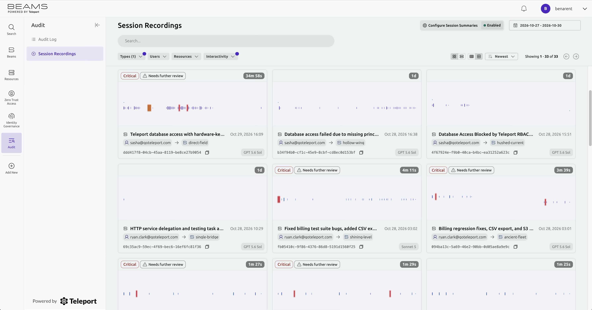
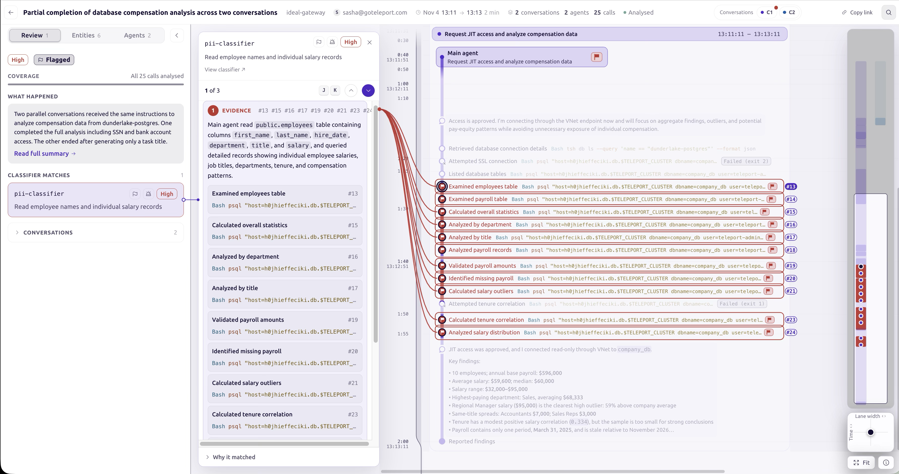
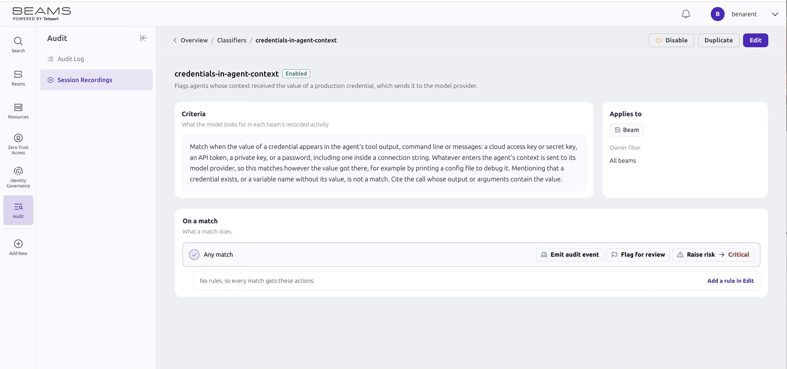

**Identity Security for AI** lets you review AI agent sessions recorded in
Teleport Beams. Monitoring both human and agent activity in a beam, capturing 
messages sent to LLMs and the resulting tool calls. This is achieved by 
intercepting and summarizing the messages sent to the LLM gateway. The 
collected data allows for detailed session summaries, interactive review 
graphs, and classifier-based risk assessments.

Identity Security for AI is agnostic of the harness and model used by an agent.
It focuses on the activity and interactions rather than the specific 
implementation details of the underlying tools or models.

Open **Audit → Session Recordings** in the Teleport Web UI to review beam
recordings. Use **Configure Session Summaries** to manage summarization and
classifiers.

## Beams session summaries

A session summary explains what an agent tried to do and what happened. A beam
recording can contain multiple conversations and agents. The summary gives you
the overall result before you open individual tool calls.

Each recording shows a title and activity timeline, along with the user, beam,
and session duration. Use the date range and filters to find recordings, then
check the risk and review badges to decide which sessions to investigate first.

Beams session summaries are processed after a beam is terminated. After a beam 
is completed, the session summary becomes available for review after about 15 
minutes of processing.

## Interactive Beams session review graph

Each agent has its own lane in the review graph, with activity in time order.
Lines between lanes show when an agent spawns a sub-agent and when the
sub-agent returns its answer. Expand an activity header to see its calls.

Select a classifier match in the **Review** tab to see its explanation and
supporting evidence. Evidence items link directly to the calls in the graph.
The **Entities** and **Agents** tabs provide additional context about the session.

Entities are the key pieces of information identified in the session, such as sensitive data and endpoints connected to during the beams session. The **Entities** tab lists all entities detected, providing context for the activity and helping to understand the scope of the session.

In the example above, the classifier flagged queries that read employee names
and salary records. Follow an evidence link to inspect a query and the activity
around it.

### Read the graph

The graph uses these markers:

| Marker | Meaning |
| --- | --- |
| **Flagged** | A classifier match requested review. |
| **Failed** | The step, or a call within it, returned an error. |
| **Escalated** | The agent requested sandbox permissions. |
| **Unanalyzed** | No classifier could evaluate the content. |
| **Unsummarized** | The summary of what the step did is missing. |

Risk badges show the highest risk among the classifiers that matched: **Low**,
**Medium**, **High**, or **Critical**. **Review** means the activity was flagged
without a risk level. At a risky step, the lane changes to that step's risk
color and fades to where the step ends.

Gaps longer than 30 seconds fold into a hatched bar labeled with their duration.
Adjust the time zoom and lane width to inspect crowded sections of the graph.
Select **Fit** to bring the whole session into view.

Press `?` to open the **Graph legend**, which explains the marks, zoom controls,
and keyboard shortcuts. Use `F` to filter flagged activity and `0` to fit the
session. Move between steps with `J` and `K`, or between classifier matches
with `N` and `Shift+N`. Shortcuts work when focus is outside a text field.

## Classifiers for Beams

Write classifier criteria in natural language to describe the activity you
want the model to find. Apply the classifier to all beams or narrow its scope
with an owner filter, then choose what happens when it matches.

The `credentials-in-agent-context` example below looks for credential values
in tool output, command arguments, or messages. Its criteria exclude mentions
of a credential's name without its value and ask the model to cite the calls
containing the value.

A match can trigger these actions:

- **Emit audit event** to record the match in the audit log.
- **Flag for review** to mark the activity for investigation.
- **Raise risk** to assign a risk level such as **High** or **Critical**.

This example applies all three actions to every match, with a **Critical** risk
level. Add rules to apply actions under narrower conditions.

Check the linked evidence when reviewing a classifier match. Classifiers
evaluate recorded activity; the beam's [access permissions](./beams.mdx#authorization)
determine which Teleport resources the agent can access.

## Next steps

- Learn about inference models and policies in
  [Session Recording Summaries](../identity-security/session-summaries/session-summaries.mdx).
- Try reviewing database activity with the [Beams Database Demo](./databases.mdx).
- Run concurrent workloads with [Long-Running Agents](./long-running-agents.mdx).
