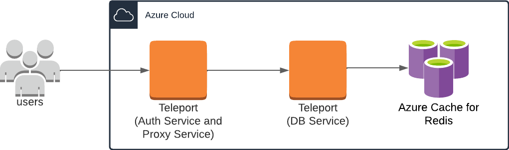
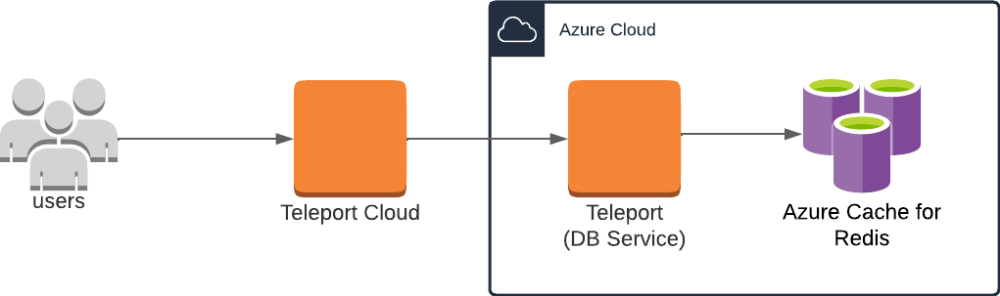
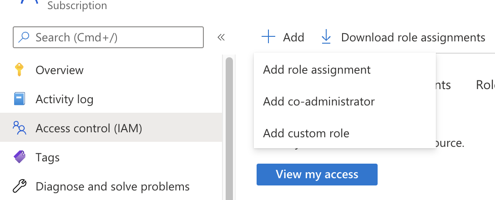
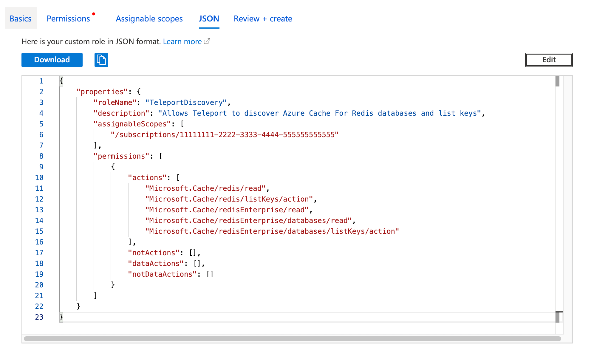

(!docs/pages/includes/database-access/db-introduction.mdx dbType="Azure Cache for Redis" dbConfigure="with Microsoft Entra ID-based authentication"!)

## How it works

The Teleport Database Service proxies traffic between Teleport users and **Azure
Cache for Redis**. When a user connects to the database via Teleport, the Database
Service obtains an access token from **Microsoft Entra ID** and authenticates to
Azure as a principal with permissions to manage the database. The Database Service
uses this permission to retrieve the database's access key, then uses the access
key to authenticate the Redis connection on the user's behalf.

<Tabs>
<TabItem scope={["oss", "enterprise"]} label="Self-Hosted">

</TabItem>

<TabItem scope={["cloud"]} label="Teleport Enterprise Cloud">

</TabItem>

</Tabs>

## Prerequisites

(!docs/pages/includes/edition-prereqs-tabs.mdx!)

- Deployed Azure Redis server or Azure Redis Enterprise cluster.
- Azure administrative privileges to manage service principals and access
  controls.
- A host, e.g., an Azure VM instance, where you will run the Teleport Database
  Service.
- Follow the [redis-cli installation instructions](https://redis.io/docs/latest/operate/oss_and_stack/install/install-stack/install-redis-cli/) 
  for your platform, then confirm it works by running `redis-cli -v`. This guide was tested against `v8.10.2`.
- (!docs/pages/includes/tctl.mdx!)

## Step 1/5. Create a Teleport token and user

(!docs/pages/includes/tctl-token.mdx serviceName="Database" tokenType="db" tokenFile="/tmp/token"!)

(!docs/pages/includes/database-access/create-user.mdx!)

## Step 2/5. Create a Database Service configuration

Install Teleport on the host where you will run the Teleport Database Service:

(!docs/pages/includes/install-linux.mdx!)

Create the Database Service configuration, specifying a region like this:

<Tabs>
<TabItem scope={["oss", "enterprise"]} label="Self-Hosted">

```code
$ sudo teleport db configure create \
  -o file \
  --proxy=teleport.example.com:443 \
  --token=/tmp/token \
  --azure-redis-discovery=eastus
```
</TabItem>
<TabItem scope={["cloud"]} label="Teleport Enterprise Cloud">

```code
$ sudo teleport db configure create \
  -o file \
  --proxy=example.teleport.sh:443 \
  --token=/tmp/token \
  --azure-redis-discovery=eastus
```
</TabItem>

</Tabs>

The command generates a Database Service configuration with Azure Cache for
Redis auto-discovery enabled in the `eastus` region and places it at
`/etc/teleport.yaml`.

Use `--azure-redis-discovery=*` to discover databases in all regions. To
further narrow the scope of auto-discovery, add `--azure-resource-group=<resource-group-name>`
or `--azure-subscription=<subscription-id>`. To match databases by Azure
resource tag instead, use `--azure-tags=<key>=<value>`. Do not use `--labels`
for this purpose: `--labels` only sets static labels on a manually configured
database entry and has no effect on which resources Teleport auto-discovers.

## Step 3/5. Configure IAM permissions for Teleport

The Teleport Database Service needs Azure IAM permissions to:

- Discover and register Azure Cache for Redis databases. 
- Retrieve Redis access keys to authenticate with the databases.

### Configure an Azure service principal

(!docs/pages/includes/database-access/azure-configure-service-principal.mdx!)

### Create a custom role

Teleport requires `<resource-type>/read` permissions for discovery and
`<resource-type>/listKeys/action` permissions for authentication with the
Redis servers, but Teleport only needs permissions for the resource types
you have.

Here is a sample role definition allowing Teleport to read and list keys
for both Azure Redis and Azure Redis Enterprise:
```json
{
    "properties": {
        "roleName": "TeleportDiscovery",
        "description": "Allows Teleport to discover Azure Cache For Redis databases and list keys",
        "assignableScopes": [
            "/subscriptions/11111111-2222-3333-4444-555555555555"
        ],
        "permissions": [
            {
                "actions": [
                    "Microsoft.Cache/redis/read",
                    "Microsoft.Cache/redis/listKeys/action",
                    "Microsoft.Cache/redisEnterprise/read",
                    "Microsoft.Cache/redisEnterprise/databases/read",
                    "Microsoft.Cache/redisEnterprise/databases/listKeys/action"
                ],
                "notActions": [],
                "dataActions": [],
                "notDataActions": []
            }
        ]
    }
}
```

The `assignableScopes` field above includes a subscription (`/subscriptions/<subscription-id>`), which allows the 
role to be assigned at any resource scope within that subscription or at the subscription scope itself. You can 
instead set `assignableScopes` to a management group or a resource group, depending on how broadly you want the 
role to be assignable. See [Understand scope for Azure RBAC](https://learn.microsoft.com/en-us/azure/role-based-access-control/scope-overview).

Go to the [Subscriptions](https://portal.azure.com/#view/Microsoft_Azure_Billing/SubscriptionsBlade)
page and select a subscription.

Click **Access control (IAM)** in the subscription and select **Add > Add
custom role**:


In the custom role creation page, click the **JSON** tab and click **Edit**,
then paste the JSON example and replace the subscription in
`assignableScopes` with your own subscription ID:


### Create a role assignment for the Teleport Database Service principal

(!docs/pages/includes/database-access/azure-assign-service-principal.mdx!)

## Step 4/5. Start the Database Service

(!docs/pages/includes/start-teleport.mdx service="the Teleport Database Service"!)

## Step 5/5. Connect

Log in to your Teleport cluster. Your Azure Cache for Redis databases should
appear in the list of available databases:

<Tabs>
<TabItem scope={["oss", "enterprise"]} label="Self-Hosted">

```code
$ tsh login --proxy=teleport.example.com --user=alice
$ tsh db ls
Name                      Description                              Allowed Users Labels  Connect 
------------------------- ---------------------------------------- ------------- ------- ------- 
my-azure-redis            Azure Redis server in East US            [*]           ...
my-azure-redis-enterprise Azure Redis Enterprise server in East US [*]           ...
```

</TabItem>

<TabItem scope={["cloud"]} label="Teleport Enterprise Cloud">

```code
$ tsh login --proxy=example.teleport.sh --user=alice
$ tsh db ls
Name                      Description                              Allowed Users Labels  Connect 
------------------------- ---------------------------------------- ------------- ------- ------- 
my-azure-redis            Azure Redis server in East US            [*]           ...
my-azure-redis-enterprise Azure Redis Enterprise server in East US [*]           ...
```

</TabItem>

</Tabs>

By default, Teleport uses the name of the Azure Cache for Redis resource as
the database name. To override this, apply the `TeleportDatabaseName` Azure
tag to the resource. The value of the tag is used as the database name.

To retrieve credentials for a database and connect to it:

```code
$ tsh db connect my-azure-redis
```

The Teleport Database Service retrieves the access key and authenticates
with the Redis server on the backend automatically. You do not need to run
the `AUTH <access-key>` command yourself once connected.

(!docs/pages/includes/database-access/proxy-db-tunnel.mdx db="my-azure-redis"!)


To log out of the database and remove credentials:

```code
$ tsh db logout my-azure-redis
```

## Troubleshooting

(!docs/pages/includes/database-access/azure-troubleshooting.mdx!)

## Next steps

(!docs/pages/includes/database-access/guides-next-steps.mdx!)

## Further reading
- [Understand Azure Role Definitions - AssignableScopes](https://learn.microsoft.com/en-us/azure/role-based-access-control/role-definitions#assignablescopes)
- [Azure RBAC custom roles](https://docs.microsoft.com/en-us/azure/role-based-access-control/custom-roles)
