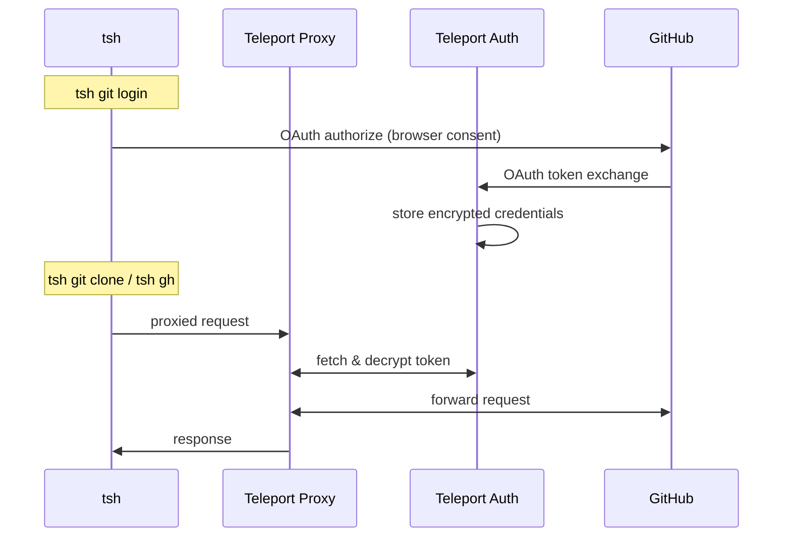
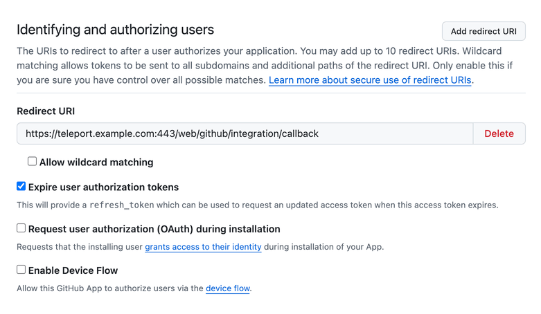
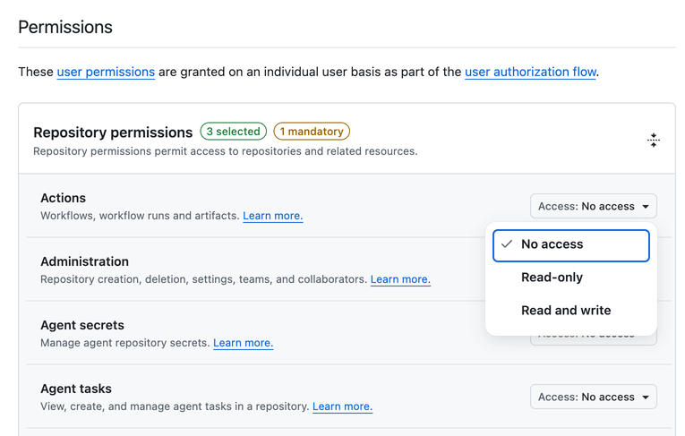
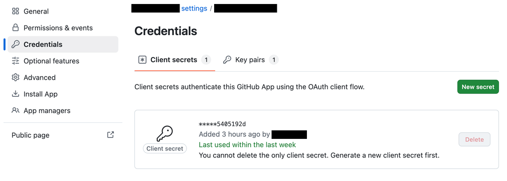
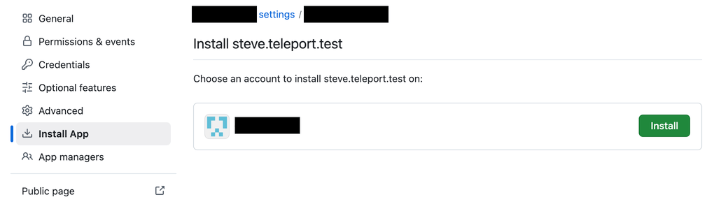

Teleport protects your GitHub organization with a GitHub App scoped to specific
repositories and permissions. `git` and `gh` commands go through Teleport with
short-lived credentials instead of long-lived personal access tokens and SSH
keys. Teleport records this activity in its audit log.

In this guide, you will:
- Connect a GitHub organization to Teleport.
- Configure access for a user.
- Clone a repository and use the `gh` CLI through Teleport.

## How it works

Teleport uses a private GitHub App installed on your organization to
authenticate on behalf of users. Once a user authorizes the app, Teleport
proxies their Git commands and `gh` CLI calls using securely-stored,
short-lived OAuth tokens.



A user's effective access is the intersection of what Teleport's RBAC
allows, what the GitHub App's installation grants, and what the user's own
GitHub permissions cover.

## Prerequisites

(!docs/pages/includes/edition-prereqs-tabs.mdx!)
- (!docs/pages/includes/tctl.mdx!)

(!docs/pages/includes/git-platforms/github-https-prereqs.mdx!)

## Step 1/3. Connect your GitHub organization

Run the following command, replacing <Var name="doc-example-org" /> with your
organization's name:

```code
$ tctl integrations github add --org <Var name="doc-example-org" />
This command connects your GitHub organization to Teleport for Git over HTTPS:

  "<Var name="doc-example-org" />"

Prerequisites:
  - You are an owner of the GitHub organization.
  - You are a Teleport admin who can create integrations and git servers,
    for example with the preset editor role.
  - If the organization is on GitHub Enterprise, the Teleport cluster has a
    Teleport Enterprise license.

Steps:
  1. On your behalf, tctl creates the Teleport resources for the GitHub integration.
  2. In your browser, you create the GitHub App "teleport.example.com",
     requesting read and write access to contents, issues and pull
     requests. You can customize its name there.
  3. On your behalf, tctl saves the GitHub App credentials in Teleport.
  4. In your browser, you install the GitHub App in "<Var name="doc-example-org" />"
     and choose which repositories it can access.

If a step fails, tctl deletes the Teleport resources it created.

Proceed with GitHub App creation [y/N]: y
```

The command opens your browser once, to create a GitHub App in your
organization from a predefined manifest. After you approve, you're
redirected to install the app in <Var name="doc-example-org" /> and choose
which repositories it can access.

<Admonition type="note" title="Customizing GitHub App permissions">
The GitHub App is created with read and write access to contents, issues, and
pull requests. You can always go to the app's settings on GitHub to change
its permissions if needed.
</Admonition>

To set up the GitHub App and Teleport resources without
`tctl integrations github add`, see
[Set up the GitHub App manually](#set-up-the-github-app-manually).

## Step 2/3. Configure access

(!docs/pages/includes/git-platforms/configure-access.mdx!)

## Step 3/3. Connect

(!docs/pages/includes/git-platforms/tsh-git-ls.mdx!)

(!docs/pages/includes/git-platforms/tsh-git-login.mdx!)

(!docs/pages/includes/git-platforms/tsh-git-clone-http.mdx!)

(!docs/pages/includes/git-platforms/tsh-gh.mdx!)

## Troubleshooting

(!docs/pages/includes/git-platforms/redirect-uri-error.mdx!)

## Set up the GitHub App manually

Instead of running `tctl integrations github add` in Step 1, you can create the
GitHub App and Teleport resources yourself. Then continue with
[Step 2](#step-23-configure-access).

### Create the GitHub App

Go to **GitHub Apps** under **Developer Settings** of your organization's
settings.

Click on **New GitHub App** and fill in the details:
- **GitHub App name**: a name of your choosing, for example, your Teleport
  cluster's name.
- **Homepage URL**: the address of your Teleport Proxy Service. Replace
  <Var name="teleport.example.com:443" /> with its host and web port:
  ```code
  https://<Var name="teleport.example.com:443" />
  ```
- **Callback URL**: the GitHub integration's OAuth callback, which GitHub
  matches exactly:
  ```code
  https://<Var name="teleport.example.com:443" />/web/github/integration/callback
  ```
- Keep **Expire user authorization tokens** checked, which is the default.
- Leave the **Webhook** **Active** checkbox unchecked. Teleport does not use
  GitHub webhooks.



Under **Repository permissions**, grant the permissions your use case
needs. A common starting point for general development is **Read and
write** access to **Contents**, **Issues**, and **Pull requests**.



Click **Create GitHub App**.

### Create a client secret

On the GitHub app's page, select **Credentials**, then under **Client
secrets**, click **New secret**.



Remember the client ID and the secret for the next step.

### Install the GitHub App

On the GitHub app's page, click **Install App**, select
<Var name="doc-example-org" />, and choose which repositories it can
access. You can change this later from the installation's configuration page.



### Create Teleport resources

(!docs/pages/includes/git-platforms/create-integration.mdx!)

(!docs/pages/includes/git-platforms/create-git-server.mdx!)

## Differences from GitHub over SSH

Teleport also supports [GitHub over SSH](github-ssh.mdx). The two protocols
differ in a few ways:

(!docs/pages/includes/git-platforms/github-https-ssh-differences.mdx!)

## Next steps

- [Access Controls for Git Platforms](access-controls.mdx): configure a custom
  role instead of the preset `access` role.
- [Creating a GitHub App](https://docs.github.com/en/apps/creating-github-apps/about-creating-github-apps/about-creating-github-apps)
  in the GitHub documentation.
