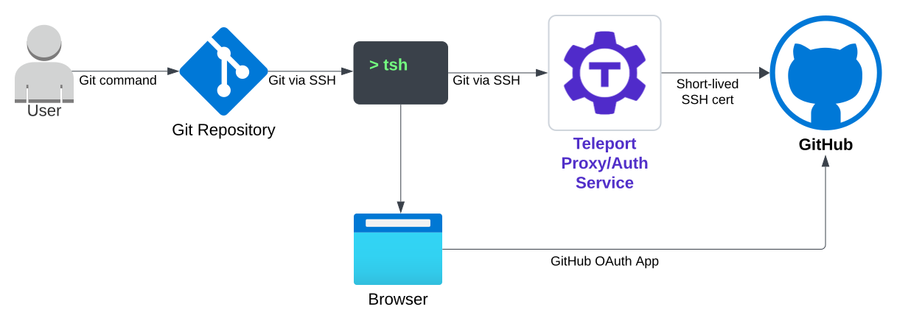
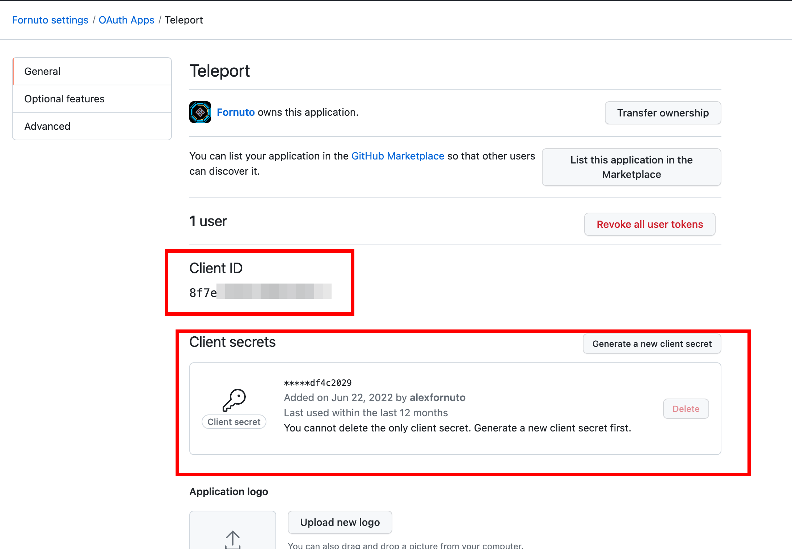
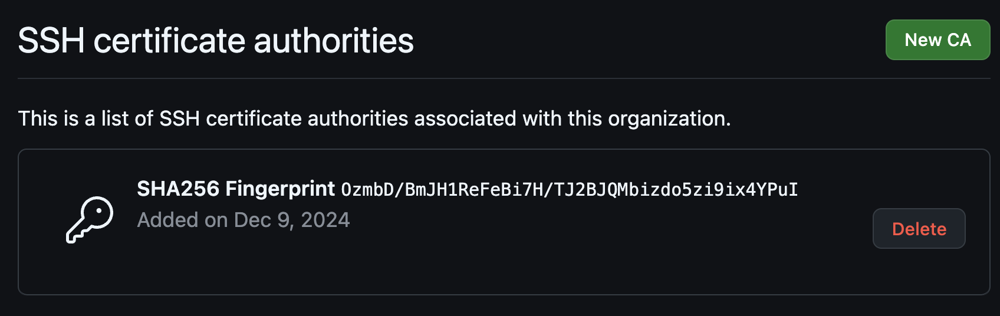

Teleport protects GitHub organizations with short-lived SSH certificates
instead of long-lived personal access tokens and SSH keys.

Teleport also supports [GitHub over HTTPS](github-https.mdx), which
additionally allows the `gh` CLI. See
[Differences from GitHub over HTTPS](#differences-from-github-over-https)
for details.

In this guide, you will:
- Create a GitHub OAuth application.
- Configure SSH certificate authorities for your GitHub organizations.
- Create Teleport resources for the GitHub integration.
- Run Git commands through Teleport.

## How it works

GitHub enables organizations to configure a list of SSH Certificate Authorities
(CAs) for authentication. This feature allows access to the organization's
repositories using short-lived SSH certificates signed by an approved CA, such
as a Teleport CA. Optionally, organizations can enforce stricter security by
requiring these signed SSH certificates for access, effectively disabling the
use of personal SSH keys and access tokens.

Teleport users can configure their Git repositories to proxy through Teleport.
After setup, Git commands automatically route through Teleport, which
impersonates their GitHub identities using short-lived SSH certificates signed
by Teleport's CA for authentication with GitHub. Teleport also records this
activity in its audit log.

To retrieve a user's GitHub identity, `tsh` initiates the GitHub OAuth flow by
opening a browser window for the user to log in with their GitHub credentials.



Note that Teleport proxies Git commands through SSH but the users should
continue to access GitHub through their browsers.

## Prerequisites

(!docs/pages/includes/edition-prereqs-tabs.mdx edition="Teleport Enterprise (v17.2 or higher)"!)
- Access to **GitHub Enterprise Cloud** and permissions to modify GitHub's SSH
  certificate authorities and configure OAuth applications.
  <Admonition type="info" title="GitHub Enterprise compatibility">
  GitHub integration requires a GitHub Enterprise plan and is currently
  supported for GitHub Enterprise Cloud. Support for GitHub Enterprise
  Server (self-hosted) is not available as of the current release.
  </Admonition>
- (!docs/pages/includes/tctl.mdx!)
- Git locally installed

## Step 1/4. Configure a GitHub OAuth application

The GitHub integration requires a GitHub OAuth application to obtain users'
GitHub identities. If your Teleport cluster uses GitHub SSO for login, the
GitHub identities are already available from the SSO flow and you can skip this
step. For clusters that use local users and other SSO providers in addition to
the GitHub SSO connector, a dedicated OAuth application for GitHub integration
is recommended.

Go to "OAuth Apps" under "Developer Settings" of your organization's settings.
Click on "New OAuth App".

Fill in the details. Use the following for "Redirect URIs".
Replace <Var name="teleport.example.com:443" /> with the host and web
port of your Teleport Proxy Service:

```code
https://<Var name="teleport.example.com:443" />/web/github/integration/callback
```

Once the OAuth application is created, create a client secret and remember the
client ID and the secret for the next step:



## Step 2/4. Create a GitHub integration and export the CAs

(!docs/pages/includes/git-platforms/create-integration.mdx protocol="ssh"!)

Once the integration resource is created, export the CA to be used for GitHub:
```code
$ tctl auth export --type github --integration github-<Var name="doc-example-org"/>
```

Now go to the "Authentication Security" page of your GitHub organization. Click
on "New CA" under the "SSH certificate authorities" section, and paste the CA
exported from the `tctl auth export` command above.



## Step 3/4. Configure access

(!docs/pages/includes/git-platforms/create-git-server.mdx protocol="ssh"!)

The user role must have `github_permissions` configured to allow access to your
GitHub organization. For example:
```yaml
# role_with_github_permissions.yaml
kind: role
metadata:
  name: github-access
spec:
  allow:
    github_permissions:
    - orgs:
      - <Var name="doc-example-org"/>
version: v8
```

(!docs/pages/includes/add-role-to-user.mdx role="github-access"!)

## Step 4/4. Connect

(!docs/pages/includes/git-platforms/tsh-git-ls.mdx!)

(!docs/pages/includes/git-platforms/tsh-git-login.mdx authScreenshot="../../../img/github-sso-auth-screen.jpg"!)

(!docs/pages/includes/git-platforms/tsh-git-clone-ssh.mdx!)

## Migrate to the authenticated callback URL

Existing integrations may use the old unauthenticated callback URL
(`/v1/webapi/github/callback`). To improve security, migrate to the new
authenticated callback URL.

First, go to the settings page for your GitHub OAuth application. Add the
following to "Redirect URIs". Replace
<Var name="teleport.example.com:443" /> with the host and web port of
your Teleport Proxy Service:

```code
https://<Var name="teleport.example.com:443" />/web/github/integration/callback
```

If the same OAuth application is also used for GitHub SSO login, keep the
existing callback URL used for GitHub SSO (for example,
`https://<Var name="teleport.example.com:443" />/v1/webapi/github/callback`)
and add the new URL as an additional redirect URI. GitHub OAuth applications
support multiple redirect URIs.

Then update the Teleport integration resource:

```code
$ tctl edit integration/github-<Var name="doc-example-org"/>
```

Set `oauth_callback_url` under the `github` spec:

```yaml
spec:
  github:
    organization: <Var name="doc-example-org"/>
    oauth_callback_url: https://<Var name="teleport.example.com:443" />/web/github/integration/callback
```

## Troubleshooting

(!docs/pages/includes/git-platforms/redirect-uri-error.mdx!)

If you have not migrated to the authenticated callback URL, see
[Migrate to the authenticated callback URL](#migrate-to-the-authenticated-callback-url).

## Differences from GitHub over HTTPS

Teleport also supports [GitHub over HTTPS](github-https.mdx). The two
protocols differ in a few ways:

(!docs/pages/includes/git-platforms/github-https-ssh-differences.mdx!)

## Further reading
- [Creating a GitHub OAuth app](https://docs.github.com/en/apps/oauth-apps/building-oauth-apps/creating-an-oauth-app)
- [GitHub SSH certificate authorities](https://docs.github.com/en/enterprise-cloud@latest/organizations/managing-git-access-to-your-organizations-repositories/about-ssh-certificate-authorities)
