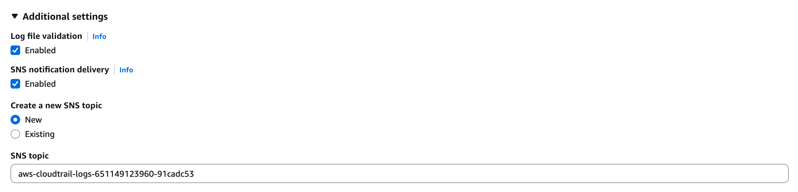
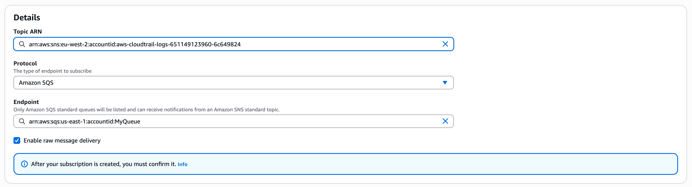
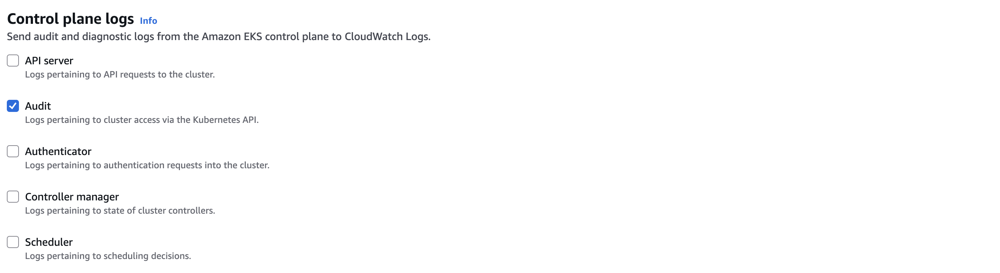

Teleport Identity Security scans the IAM users, groups, roles, policies, and resources in
your AWS account and renders them as a graph so you can answer questions such
as:

- What resources are accessible to AWS users and roles?
- Which resources can be reached via identities associated with EC2 instances?
- What AWS resources can Teleport users access when connecting to EC2 nodes?

Two Identity Security components take part in this integration:

- The **Access Graph Service** is the backend that stores and analyzes the
  resources imported from AWS. Teleport Enterprise (Cloud) runs it for you;
  self-hosted clusters deploy it alongside Teleport.
- **Identity Activity Center** is the Access Graph Service component that
  ingests, stores, and analyzes activity logs from sources such as AWS
  CloudTrail, Amazon EKS, Okta, and GitHub, and correlates them with the access
  paths in the graph. In the Teleport Web UI, this activity appears under
  **Identity Security** > **Investigate**. Self-hosted clusters must
  [enable Identity Activity Center](../access-graph/identity-activity-center.mdx)
  on the Access Graph Service before using the optional steps in this guide.

Importing AWS resources requires the Access Graph Service, a Teleport Discovery
Service, and a Teleport integration with your AWS account. This guide shows you
how to set up each of them, plus the optional CloudTrail and EKS audit log
integrations for Identity Activity Center.

(!docs/pages/includes/policy/access-graph.mdx!)

## How it works

Access Graph synchronizes IAM policies, groups, users, roles, EC2 instances,
EKS clusters, RDS databases, S3 buckets, and KMS keys from your AWS account and
visualizes them using the graph representation described in the
[Identity Security usage page](../usage/usage.mdx).

The import process has two required steps and two optional ones.

### Polling cloud APIs

The Teleport Discovery Service scans the configured AWS accounts every 15
minutes and retrieves the following resources:

- Users
- Groups
- User Groups
- IAM Roles
- IAM Policies
- EC2 Instances
- EKS Clusters
- RDS Databases
- S3 Buckets
- KMS Keys

Once all resources are fetched, the Discovery Service pushes them to Access
Graph so the graph reflects the current state of your AWS environment.

### Importing resources

Access Graph evaluates the IAM policies, identities, and resources retrieved
from your AWS account and builds the graph from them.

### Importing AWS CloudTrail logs (optional)

If CloudTrail is configured to log activity in your AWS account, it delivers log
files to an S3 bucket. To process trail data in near real time, you enable
Amazon SNS notifications on the trail so that a notification is sent whenever a
new log file is written, and subscribe an SQS queue to that SNS topic to buffer
the notifications.

The Discovery Service polls the SQS queue through the Teleport AWS integration.
Each message contains the bucket name and object key of a new CloudTrail log
file, which the Discovery Service fetches directly from S3 and forwards to
Identity Activity Center. Identity Activity Center parses and stores the events
and makes them available in the **Investigate** view, giving you continuous
visibility into activity across AWS services, including login attempts, API
calls, and infrastructure changes.

### Importing Amazon EKS API server audit logs (optional)

If EKS is configured to send API server audit logs to CloudWatch Logs, the
Discovery Service fetches the logs continuously and forwards them to Identity
Activity Center, which parses and stores them for audit and security analysis.
This gives you continuous visibility into activity within your EKS clusters
alongside the rest of your AWS activity.

## Prerequisites

- A running Teleport Enterprise cluster v18.0.0 or later.
- Identity Security enabled for your account.
- For self-hosted clusters:
  - An up-to-date `license.pem` in the Auth Service configuration.
  - A running Access Graph node v1.28.0 or later. See the
    [Identity Security page](../identity-security.mdx) for details on how to
    set up Access Graph.
  - The node running the Access Graph Service must be reachable from the
    Teleport Auth Service and from the machine running the Discovery Service.
- An AWS principal with permission to manage CloudTrail, SNS, SQS, EKS, S3, KMS and IAM
  in the target account. The AWS CLI steps in this guide assume the AWS CLI is
  installed and authenticated against that account.
- For the optional Identity Activity Center integrations (Steps 2 and 3):
  - Identity Activity Center enabled on your Access Graph Service. For
    self-hosted clusters, see
    [Self-Hosting Identity Activity Center](../access-graph/identity-activity-center.mdx).
  - An existing CloudTrail trail, or permission to create one.
  - If your trail delivers log files to an S3 bucket or publishes to an SNS
    topic owned by a different AWS account, the ability to edit the resource
    policies in that account. See the cross-account notes at the start of
    Step 2.

Steps 2 and 3 are optional and only apply if you use Identity Activity Center.
Step 4 asks for values produced in Step 2, so complete Step 2 before Step 4.

## Step 1/4. Configure the Discovery Service (self-hosted only)

<Admonition type="warning">

If you have a cloud-hosted Teleport Enterprise cluster, skip this step.
Cloud-hosted Teleport Enterprise already operates a properly configured
Discovery Service within your cluster.

</Admonition>

To activate the Teleport Discovery Service, add a top-level `discovery_service`
section to the `teleport.yaml` configuration used by the Auth Service. This
service monitors dynamic `discovery_config` resources whose `discovery_group`
matches <Var name="discovery-group" />:

```yaml
discovery_service:
  enabled: true
  discovery_group: <Var name="discovery-group" />
```

If you already operate a Discovery Service within your cluster, you can reuse it
as long as the following requirements are met:

- In Step 3 and Step 4, you use the existing Discovery Service's
  `discovery_group` as <Var name="discovery-group" />.
- The Access Graph Service is reachable from the machine where the Discovery
  Service runs.

## Step 2/4. Integrate CloudTrail events for Identity Activity Center (optional)

The Identity Activity Center CloudTrail integration can use an existing
CloudTrail trail or a new one. Trails can be scoped to a single AWS account or
configured as an AWS Organizations trail to collect events from multiple
accounts. If you already have a trail, we recommend reusing it to reduce costs.

By the end of this step, you will have recorded the following values, which
the setup wizard asks for in Step 4:

- The URL of the SQS queue that receives trail notifications, in the form
  `https://sqs.<region>.amazonaws.com/<account-id>/<queue-name>`. The setup
  wizard requires the URL, not the ARN.
- The ARN of the S3 bucket where the trail delivers log files.
- The ARN of the KMS key that encrypts the S3 bucket, if the bucket uses KMS,
  and the ARN of the KMS key that encrypts the SQS queue, if you enable queue
  encryption. The two are independent: an existing trail's bucket may already
  use KMS even if you leave the queue unencrypted.

Although optional, KMS encryption for both the SQS queue and the S3 bucket is
strongly recommended.

The instructions in this step assume that:

- The trail, its S3 bucket, its SNS topic, and the SQS queue you create all
  belong to the same AWS account.
- That account is in the commercial AWS partition. In AWS GovCloud, replace the
  `arn:aws:` prefix in every ARN in this guide with `arn:aws-us-gov:`.

If your trail delivers to a bucket or publishes to a topic in another account,
which is common with AWS Organizations trails and centralized logging accounts,
the owning account must also grant access in its resource policies. The IAM
policy in Step 4 alone is not sufficient. In the owning account:

- The bucket policy must allow the Teleport integration role to read log
  files.
- The bucket's KMS key policy, if the bucket uses KMS, must allow the Teleport
  integration role to decrypt log files.
- The topic policy must grant `sns:Subscribe` to the account that owns the SQS
  queue.

Follow the cross-account procedures in the AWS S3, KMS, and SNS documentation
for those grants.

The instructions below use the AWS Console. To complete this step with the AWS
CLI instead, for example when scripting the setup, follow
[Configure CloudTrail notifications with the AWS CLI](#configure-cloudtrail-notifications-with-the-aws-cli)
at the end of this guide, then continue with Step 3.

1. In the CloudTrail console, open your trail's settings. If **SNS
   notification delivery** is already enabled, note the existing topic and
   reuse it in the following steps; selecting a different topic would
   stop existing subscribers from receiving notifications. If it is not
   enabled, enable it and create a new SNS topic.

   

1. Still in the trail's details page, record the values Step 4 needs from
   the trail:

   - Under **Storage location**, note the S3 bucket name. The bucket ARN is
     `arn:aws:s3:::<bucket-name>`.
   - Under **Log file SSE-KMS encryption**, if a KMS key is shown, open it in
     the KMS console and record its **ARN**. If no key is shown, open the
     bucket in the S3 console, go to **Properties**, and check **Default
     encryption**. If the encryption type is **SSE-KMS**, open the key and
     record its **ARN**. In both cases record the ARN shown in the KMS
     console, not the key ID or alias.

1. In the SQS console, create a new Standard queue. The queue must be dedicated
   to trail SNS notifications. From the queue's details page, record the
   **URL** and the **ARN** for Step 4.

1. Subscribe the queue to the SNS topic from the SQS console: open the queue,
   select the **SNS subscriptions** tab, and choose **Subscribe to Amazon SNS
   topic**.

   Subscribe from the SQS console, not the SNS console. The SQS console adds
   the access policy statement that allows the topic to send messages to the
   queue; the SNS console does not, and notifications are silently dropped.
   The generated statement grants `sqs:SendMessage` to `sns.amazonaws.com`
   with an `aws:SourceArn` condition on the topic.

   If the topic and queue are in different regions and either is an opt-in
   region, edit the queue's **Access policy** and replace the principal with
   the regionalized form described in
   [Allow the topic to send messages to the queue](#allow-the-topic-to-send-messages-to-the-queue).

1. Open the new subscription in the SNS console and select **Enable raw
   message delivery**. This setting is required; without it, Identity Activity
   Center cannot parse the notifications.

   

1. (Optional) Enable KMS encryption on the queue using a customer-managed
   key. The AWS-managed `alias/aws/sqs` key cannot be used, because its key
   policy cannot be edited to grant SNS access. In the KMS console, edit the
   key policy and add a statement allowing the SNS service principal to call
   `kms:GenerateDataKey*` and `kms:Decrypt`, with an `aws:SourceArn`
   condition equal to the trail's SNS topic ARN. Use the same principal as in
   the queue's access policy (`sns.amazonaws.com`, or the regionalized form
   for opt-in cross-region pairs). Without this statement SNS cannot deliver
   messages to the encrypted queue. Record the key's **ARN** for Step 4.

## Step 3/4. Integrate Amazon EKS CloudWatch audit logs for Identity Activity Center (optional)

Enable API server audit logging on each EKS cluster whose activity you want in
Identity Activity Center.

<Tabs>
<TabItem label="AWS CLI">

Run the following command for each cluster, replacing
<Var name="eks-cluster-name" /> with the cluster name and
<Var name="aws-region" /> with its region:

```code
$ aws eks update-cluster-config \
  --region <Var name="aws-region" /> \
  --name <Var name="eks-cluster-name" /> \
  --logging '{"clusterLogging":[{"types":["audit"],"enabled":true}]}'
```

</TabItem>
<TabItem label="AWS Console">

In the EKS console, open the cluster, select the **Observability** tab, and in
the **Control plane logs** section click **Manage**. Select the **Audit**
checkbox to send audit logs to CloudWatch Logs.



</TabItem>
</Tabs>

The default setup performed in Step 4 fetches audit logs from all EKS clusters
in the configured AWS regions. If you want to be more selective, create a
`discovery_config` resource whose tags match the tags on the EKS clusters. Only
clusters matching the tags have their API server audit logs imported into
Identity Activity Center.

- <Var name="resource-name" />: The name of the `discovery_config` resource.
- <Var name="discovery-group" />: The `discovery_group` of the Discovery
  Service configured in Step 1.
- <Var name="regions" />: A comma-separated list of AWS regions in which to
  discover EKS clusters, for example `us-east-1, us-west-2`.
- <Var name="tag-name" />: The name of a tag that EKS clusters must have, or
  `"*"` for any tag.
- <Var name="tag-value" />: The value or list of values that the named tag must
  have, or `"*"` for any value. If a list, only one of the values needs to
  match. Add one `tag-name: tag-value` line per tag to match.

```yaml
kind: discovery_config
version: v1
metadata:
  name: <Var name="resource-name" />
spec:
  discovery_group: <Var name="discovery-group" />
  access_graph:
    aws:
      - regions: [<Var name="regions" />]
        eks_audit_logs:
          tags:
            <Var name="tag-name" />: <Var name="tag-value" />
```

1. Save this YAML configuration in a file named <Var name="discovery_config.yaml" />.

1. Apply the configuration to your cluster, replacing
   <Var name="teleport.example.com" /> with the domain name of your Teleport
   Proxy Service:

   ```code
   $ tctl create --proxy=<Var name="teleport.example.com" /> -f <Var name="discovery_config.yaml" />
   ```

Teleport imports the last seven days of audit logs from matching EKS clusters
and then continues importing new logs for as long as the cluster tags match the
discovery configuration.

## Step 4/4. Set up Access Graph AWS Sync

This step uses the setup wizard in the Teleport Web UI. The wizard does three
things: it creates or selects a Teleport AWS integration, it attaches the IAM
policies listed at the end of this step to the integration's IAM role, and it
creates a `discovery_config` resource whose `access_graph.aws` section tells the
Discovery Service which regions and log sources to import.

If you cannot use a browser, for example when automating the setup, you can
create the same resources yourself: create the Teleport AWS integration, attach
the IAM policies with the commands shown below, and create a `discovery_config`
resource with `tctl` or the Terraform provider. See
[the `discovery_config` reference](../../reference/infrastructure-as-code/terraform-provider/resources/discovery_config.mdx)
for the `access_graph.aws` fields, including `integration`, `regions`,
`cloud_trail_logs`, and `eks_audit_logs`.

1. In the Teleport Web UI, click **Identity Security** in the sidebar, then
   click **Integrations**.
1. Click **Setup new integration** and select **AWS**. If you have not
   configured a Teleport AWS integration yet, the wizard prompts you to create
   one. Otherwise, select an existing integration.
1. After you select or create the integration, the wizard displays a bash
   script to run in AWS CloudShell. The script attaches the IAM policies listed
   below to the IAM role used by the Teleport AWS integration. If you prefer to
   attach them yourself, see
   [Attaching the policies manually](#attaching-the-policies-manually) below.
1. If you enabled the CloudTrail integration, enter the SQS queue URL, S3
   bucket ARN, and KMS key ARNs you recorded in Step 2. Enter the queue URL
   (`https://sqs.…`), not the queue ARN; the wizard rejects an ARN in that
   field.
1. Once the IAM policies are attached, specify the AWS regions from which
   Teleport should import resources. This selection only affects regional
   resources and does not affect global resources such as S3 buckets, IAM
   policies, or IAM users.
1. If you are running a self-hosted cluster, enter the `discovery_group`
   configured in Step 1.

### Attaching the policies manually

The CloudShell script attaches the policies below as inline policies on the
IAM role used by the Teleport AWS integration. To do the same yourself, save
each policy document you need to a file and attach it with the AWS CLI,
replacing <Var name="integration-role-name" /> with the name of that role:

```code
$ aws iam put-role-policy \
  --role-name <Var name="integration-role-name" /> \
  --policy-name TeleportAccessGraphAWSSync \
  --policy-document file://aws-sync-policy.json
# Only if you completed Step 2:
$ aws iam put-role-policy \
  --role-name <Var name="integration-role-name" /> \
  --policy-name TeleportAccessGraphCloudTrail \
  --policy-document file://cloudtrail-policy.json
# Only if you completed Step 3:
$ aws iam put-role-policy \
  --role-name <Var name="integration-role-name" /> \
  --policy-name TeleportAccessGraphEKSAuditLogs \
  --policy-document file://eks-audit-policy.json
```

### IAM permissions required for AWS Sync

The policy consists of read-only actions that let Teleport retrieve information
from resources in your AWS account:

```json
{
  "Version": "2012-10-17",
  "Statement": [
    {
      "Effect": "Allow",
      "Action": [
        "ec2:DescribeInstances",
        "ec2:DescribeImages",
        "ec2:DescribeTags",
        "ec2:DescribeSnapshots",
        "ec2:DescribeKeyPairs",

        "eks:ListClusters",
        "eks:DescribeCluster",
        "eks:ListAccessEntries",
        "eks:ListAccessPolicies",
        "eks:ListAssociatedAccessPolicies",
        "eks:DescribeAccessEntry",

        "rds:DescribeDBInstances",
        "rds:DescribeDBClusters",
        "rds:ListTagsForResource",
        "rds:DescribeDBProxies",

        "dynamodb:ListTables",
        "dynamodb:DescribeTable",

        "redshift:DescribeClusters",
        "redshift:Describe*",

        "s3:ListAllMyBuckets",
        "s3:GetBucketPolicy",
        "s3:ListBucket",
        "s3:GetBucketLocation",
        "s3:GetBucketVersioning",
        "s3:GetBucketTagging",
        "s3:GetBucketPolicyStatus",
        "s3:GetBucketAcl",

        "iam:ListUsers",
        "iam:GetUser",
        "iam:ListRoles",
        "iam:ListGroups",
        "iam:ListPolicies",
        "iam:ListGroupsForUser",
        "iam:ListInstanceProfiles",
        "iam:ListUserPolicies",
        "iam:GetUserPolicy",
        "iam:ListAttachedUserPolicies",
        "iam:ListGroupPolicies",
        "iam:GetGroupPolicy",
        "iam:ListAttachedGroupPolicies",
        "iam:GetPolicy",
        "iam:GetPolicyVersion",
        "iam:ListRolePolicies",
        "iam:ListAttachedRolePolicies",
        "iam:GetRolePolicy",
        "iam:ListSAMLProviders",
        "iam:GetSAMLProvider",
        "iam:ListOpenIDConnectProviders",
        "iam:GetOpenIDConnectProvider",

        "kms:ListKeys",
        "kms:DescribeKey",
        "kms:ListResourceTags",
        "kms:ListAliases",
        "kms:GetKeyPolicy"
      ],
      "Resource": "*"
    }
  ]
}
```

### IAM permissions required for the CloudTrail integration

If you completed Step 2, the following additional permissions are required.
Replace the placeholders with the values you recorded in Step 2:

- <Var name="aws-sqs-queue"/>: The ARN (not the URL) of the SQS queue
  subscribed to the SNS topic that receives CloudTrail notifications. IAM
  policies reference the queue by ARN.
- <Var name="aws-s3-trail-bucket"/>: The ARN of the S3 bucket where CloudTrail
  delivers its log files.
- <Var name="aws-sqs-kms-queue-key"/>: The ARN of the KMS key used to encrypt
  messages in the SQS queue.
- <Var name="aws-s3-kms-key"/>: The ARN of the KMS key used to encrypt objects
  in the S3 bucket that stores CloudTrail logs. Teleport needs `kms:Decrypt`
  on this key to download the log files.

Include a KMS key ARN in the KMS statement's `Resource` list for each resource
that uses KMS. If only one of the queue or bucket is encrypted, remove the
unused ARN but keep the statement. Omit the KMS statement entirely only if
neither the queue nor the bucket uses KMS.

```json
{
  "Version": "2012-10-17",
  "Statement": [
    {
      "Effect": "Allow",
      "Action": [
        "sqs:ReceiveMessage",
        "sqs:DeleteMessage",
        "sqs:SendMessage"
      ],
      "Resource": "<Var name="aws-sqs-queue"/>"
    },
    {
      "Effect": "Allow",
      "Action": [
        "s3:GetObject",
        "s3:GetObjectVersion",
        "s3:ListBucket",
        "s3:ListBucketVersions",
        "s3:GetBucketLocation"
      ],
      "Resource": [
        "<Var name="aws-s3-trail-bucket"/>",
        "<Var name="aws-s3-trail-bucket"/>/*"
      ]
    },
    {
      "Effect": "Allow",
      "Action": [
        "kms:Decrypt",
        "kms:DescribeKey",
        "kms:GenerateDataKey",
        "kms:GenerateDataKeyWithoutPlaintext"
      ],
      "Resource": [
        "<Var name="aws-sqs-kms-queue-key"/>",
        "<Var name="aws-s3-kms-key"/>"
      ]
    }
  ]
}
```

### IAM permissions required for the EKS audit log integration

If you completed Step 3, the following additional permission is required:

```json
{
  "Version": "2012-10-17",
  "Statement": [
    {
      "Effect": "Allow",
      "Action": [
        "logs:FilterLogEvents"
      ],
      "Resource": "arn:aws:logs:*:*:log-group:/aws/eks/*"
    }
  ]
}
```

## Configure CloudTrail notifications with the AWS CLI

This section is the AWS CLI equivalent of Step 2. Read the introduction to
Step 2 first: it lists the values you need to record for Step 4 and the
same-account and cross-account assumptions that also apply here. When you
finish this section, continue with Step 3.

### Values used in this section

The commands below use the following values:

- <Var name="aws-region" />: The AWS region of the trail and the SQS queue.
  For an AWS Organizations trail, use the home region of the trail in the
  management account.
- <Var name="sns-region" />: The AWS region of the SNS topic. CloudTrail
  allows a trail's topic to be in a different region from the trail, and SNS
  commands must run in the topic's region. You determine this value in
  [Retrieve the trail's settings](#retrieve-the-trails-settings).
- <Var name="aws-account-id" />: The ID of the AWS account that owns the trail.
- <Var name="trail-name" />: The name of the existing CloudTrail trail.
- <Var name="sns-topic-name" />: The name of a new SNS topic to create if the
  trail does not already have one. SNS topic names may contain only letters,
  numbers, underscores, and hyphens; unlike trail names, they cannot contain
  periods.
- <Var name="sns-topic-arn" />: The ARN of the SNS topic that receives trail
  notifications. You determine this value in
  [Retrieve the trail's settings](#retrieve-the-trails-settings) or
  [Create the SNS topic](#create-the-sns-topic).
- <Var name="sqs-queue-name" />: The name of the SQS queue to create. The queue
  must be dedicated to trail notifications.

If you do not have a trail yet, create one by following the "Creating a trail
with the AWS CLI" procedure in the AWS CloudTrail documentation, which also
covers the S3 bucket policy the trail requires. Then return here with its name
as <Var name="trail-name" />.

### Retrieve the trail's settings

Retrieve the trail's SNS destination, S3 bucket, and KMS key:

```code
$ aws cloudtrail get-trail \
  --region <Var name="aws-region" /> \
  --name <Var name="trail-name" /> \
  --query 'Trail.[SnsTopicARN,S3BucketName,KmsKeyId]' \
  --output text
```

The output is three tab-separated values. Record them as follows.

**`SnsTopicARN`**: a trail has a single SNS destination, and replacing it
would stop any existing subscribers (such as security or monitoring pipelines)
from receiving notifications.

- If this value is a topic ARN, use it as <Var name="sns-topic-arn" />, set
  <Var name="sns-region" /> to the region segment of the ARN (the fourth
  colon-separated field, for example `us-west-2` in
  `arn:aws:sns:us-west-2:123456789012:my-topic`), and skip
  [Create the SNS topic](#create-the-sns-topic).
- If it is `None`, set <Var name="sns-region" /> to the same value as
  <Var name="aws-region" /> and create a topic in
  [Create the SNS topic](#create-the-sns-topic).

**`S3BucketName`**: form the bucket ARN for Step 4 as
`arn:aws:s3:::<bucket-name>`.

**`KmsKeyId`**: if this is set, the trail encrypts log files with that key. If
it is `None`, the trail does not encrypt log files itself, but the bucket may
still encrypt objects by default. Check with the following command and note
the `KMSMasterKeyID` value if one is present:

```code
$ aws s3api get-bucket-encryption --bucket <bucket-name>
```

A `ServerSideEncryptionConfigurationNotFoundError` or an `SSEAlgorithm` of
`AES256` means no KMS key is in use for the bucket. If neither the trail nor
the bucket uses KMS, skip the rest of this subsection and omit the S3 key from
Step 4.

Either field may contain a key ARN, a bare key ID, or an alias. Step 4 requires
the ARN, so resolve whichever identifier you found with KMS. KMS keys are
regional, and a trail's bucket can be in any region, so first find the
bucket's region:

```code
$ aws s3api get-bucket-location --bucket <bucket-name> --query LocationConstraint --output text
```

S3 returns two legacy values that are not region codes: `None` means
`us-east-1`, and `EU` means `eu-west-1`. Use the normalized region as
`<bucket-region>` below. If the identifier is an alias and does not already
begin with `alias/`, add that prefix. Record the output as the S3 KMS key ARN:

```code
$ aws kms describe-key \
  --region <bucket-region> \
  --key-id <key-id-or-alias> \
  --query KeyMetadata.Arn \
  --output text
```

### Create the SNS topic

Skip this subsection if the trail already has an SNS topic.

1. Confirm that no topic named <Var name="sns-topic-name" /> already exists.
   `create-topic` returns an existing topic of the same name instead of
   failing, and the next step replaces that topic's access policy, which
   would break any publishers already using it:

   ```code
   $ aws sns get-topic-attributes \
     --region <Var name="sns-region" /> \
     --topic-arn arn:aws:sns:<Var name="sns-region" />:<Var name="aws-account-id" />:<Var name="sns-topic-name" />
   ```

   The command must fail with a `NotFound` error. If it returns attributes, a
   topic with that name is in use; choose a different
   <Var name="sns-topic-name" /> and run the check again.

1. Create the SNS topic and allow CloudTrail to publish to it, then set it as
   the trail's notification destination. `set-topic-attributes` replaces the
   default access policy that `create-topic` generates; this is safe here
   because the topic is new and same-account IAM identities authorize through
   their IAM policies rather than the topic policy. Use the `TopicArn` from
   the first command's output as <Var name="sns-topic-arn" />; it has the form
   `arn:aws:sns:<Var name="sns-region" />:<Var name="aws-account-id" />:<Var name="sns-topic-name" />`:

   ```code
   $ aws sns create-topic --region <Var name="sns-region" /> --name <Var name="sns-topic-name" />
   $ aws sns set-topic-attributes \
     --region <Var name="sns-region" /> \
     --topic-arn <Var name="sns-topic-arn" /> \
     --attribute-name Policy \
     --attribute-value '{
       "Version": "2012-10-17",
       "Statement": [
         {
           "Sid": "AllowCloudTrailPublish",
           "Effect": "Allow",
           "Principal": { "Service": "cloudtrail.amazonaws.com" },
           "Action": "SNS:Publish",
           "Resource": "<Var name="sns-topic-arn" />",
           "Condition": {
             "StringEquals": {
               "aws:SourceArn": "arn:aws:cloudtrail:<Var name="aws-region" />:<Var name="aws-account-id" />:trail/<Var name="trail-name" />"
             }
           }
         }
       ]
     }'
   $ aws cloudtrail update-trail \
     --region <Var name="aws-region" /> \
     --name <Var name="trail-name" /> \
     --sns-topic-name <Var name="sns-topic-arn" />
   ```

### Create the SQS queue

1. Confirm that no queue named <Var name="sqs-queue-name" /> already exists.
   `create-queue` returns an existing queue of the same name instead of
   failing, and the following subsections replace that queue's access policy
   and subscribe it to the trail topic. Because Teleport receives and deletes
   messages from the queue, reusing an unrelated queue would cause Teleport to
   consume its messages:

   ```code
   $ aws sqs get-queue-url --region <Var name="aws-region" /> --queue-name <Var name="sqs-queue-name" />
   ```

   The command must fail with a `NonExistentQueue` error. If it returns a
   queue URL, the name is in use; choose a different
   <Var name="sqs-queue-name" /> and run the check again.

1. Create a Standard SQS queue. Record the `QueueUrl` from the first command's
   output for Step 4, and the `QueueArn` from the second command's output for
   the queue policy and subscription below. The ARN has the form
   `arn:aws:sqs:<Var name="aws-region" />:<Var name="aws-account-id" />:<Var name="sqs-queue-name" />`:

   ```code
   $ aws sqs create-queue --region <Var name="aws-region" /> --queue-name <Var name="sqs-queue-name" />
   $ aws sqs get-queue-attributes \
     --region <Var name="aws-region" /> \
     --queue-url https://sqs.<Var name="aws-region" />.amazonaws.com/<Var name="aws-account-id" />/<Var name="sqs-queue-name" /> \
     --attribute-names QueueArn
   ```

### Allow the topic to send messages to the queue

Write the queue policy to a file, then apply it. The `jq` command wraps the
policy document as the string value that the `Policy` attribute expects.

If the topic region (<Var name="sns-region" />) and the queue region
(<Var name="aws-region" />) differ and either is an opt-in region (for example
`ap-east-1`, `me-south-1`, or `af-south-1`), replace the `sns.amazonaws.com`
principal below with a regionalized principal. Which region to use depends on
the direction of delivery:

- Topic in a default-enabled region, queue in an opt-in region: use
  `sns.<Var name="aws-region" />.amazonaws.com` (the queue region).
- Topic in an opt-in region, queue in a default-enabled region: use
  `sns.<Var name="sns-region" />.amazonaws.com` (the topic region).
- Topic and queue in different opt-in regions: use
  `sns.<Var name="aws-region" />.amazonaws.com` (the queue region).

With the generic principal, SNS cannot deliver across these region pairs and
the verification count in [Verify that notifications arrive](#verify-that-notifications-arrive)
stays at zero.

```code
$ cat > queue-policy.json <<EOF
{
  "Version": "2012-10-17",
  "Statement": [
    {
      "Sid": "AllowSNSSendMessage",
      "Effect": "Allow",
      "Principal": { "Service": "sns.amazonaws.com" },
      "Action": "sqs:SendMessage",
      "Resource": "arn:aws:sqs:<Var name="aws-region" />:<Var name="aws-account-id" />:<Var name="sqs-queue-name" />",
      "Condition": {
        "ArnEquals": {
          "aws:SourceArn": "<Var name="sns-topic-arn" />"
        }
      }
    }
  ]
}
EOF
$ aws sqs set-queue-attributes \
  --region <Var name="aws-region" /> \
  --queue-url https://sqs.<Var name="aws-region" />.amazonaws.com/<Var name="aws-account-id" />/<Var name="sqs-queue-name" /> \
  --attributes "$(jq -n --rawfile p queue-policy.json '{Policy: $p}')"
```

### Subscribe the queue to the topic

Subscribe the queue to the topic with raw message delivery enabled. Raw
message delivery is required; without it, Identity Activity Center cannot
parse the notifications:

```code
$ aws sns subscribe \
  --region <Var name="sns-region" /> \
  --topic-arn <Var name="sns-topic-arn" /> \
  --protocol sqs \
  --notification-endpoint arn:aws:sqs:<Var name="aws-region" />:<Var name="aws-account-id" />:<Var name="sqs-queue-name" /> \
  --attributes RawMessageDelivery=true \
  --return-subscription-arn
```

### Encrypt the queue (optional)

Encrypt the queue with a customer-managed KMS key, replacing
<Var name="aws-sqs-kms-queue-key" /> with the key ARN. The AWS-managed
`alias/aws/sqs` key cannot be used, because its key policy cannot be edited to
grant SNS access.

1. Add the following statement to the key's policy. Without it, SNS cannot
   deliver messages to the encrypted queue. The `Principal` must match the one
   you used in the queue policy: use `sns.amazonaws.com` for same-region or
   default-enabled-region pairs, and the same regionalized principal
   otherwise. The `aws:SourceArn` condition limits the grant to this trail's
   topic:

   ```json
   {
     "Sid": "AllowSNSUseOfQueueKey",
     "Effect": "Allow",
     "Principal": { "Service": "sns.amazonaws.com" },
     "Action": [
       "kms:GenerateDataKey*",
       "kms:Decrypt"
     ],
     "Resource": "*",
     "Condition": {
       "ArnEquals": {
         "aws:SourceArn": "<Var name="sns-topic-arn" />"
       }
     }
   }
   ```

   Retrieve the current key policy, add the statement to its `Statement`
   array, and apply the result. `put-key-policy` replaces the whole policy,
   so keep the existing statements:

   ```code
   $ aws kms get-key-policy \
     --region <Var name="aws-region" /> \
     --key-id <Var name="aws-sqs-kms-queue-key" /> \
     --policy-name default \
     --query Policy \
     --output text > kms-policy.json
   # Edit kms-policy.json and add the statement above to the Statement array.
   $ aws kms put-key-policy \
     --region <Var name="aws-region" /> \
     --key-id <Var name="aws-sqs-kms-queue-key" /> \
     --policy-name default \
     --policy file://kms-policy.json
   ```

1. Enable encryption on the queue:

   ```code
   $ aws sqs set-queue-attributes \
     --region <Var name="aws-region" /> \
     --queue-url https://sqs.<Var name="aws-region" />.amazonaws.com/<Var name="aws-account-id" />/<Var name="sqs-queue-name" /> \
     --attributes KmsMasterKeyId=<Var name="aws-sqs-kms-queue-key" />
   ```

### Verify that notifications arrive

CloudTrail delivers log files roughly every five minutes, so the count below
should become non-zero shortly after the trail is active:

```code
$ aws sqs get-queue-attributes \
  --region <Var name="aws-region" /> \
  --queue-url https://sqs.<Var name="aws-region" />.amazonaws.com/<Var name="aws-account-id" />/<Var name="sqs-queue-name" /> \
  --attribute-names ApproximateNumberOfMessages
```

You now have the SQS queue URL, S3 bucket ARN, and any KMS key ARNs that Step 4
asks for. Continue with Step 3.

## Next steps

- Explore the imported resources in the
  [Identity Security usage page](../usage/usage.mdx).
