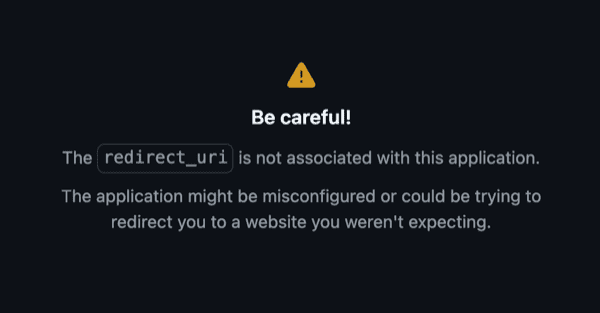

### `redirect_uri` is not associated with this application



This error from GitHub means the callback URL configured on the Teleport
integration does not match the callback URL registered on your GitHub OAuth
application or GitHub App. Verify both values match:

1. Check the callback URL on GitHub in your application's settings.
2. Check the callback URL on the Teleport integration:

```code
$ tctl get integration/github-<Var name="doc-example-org"/>
```

Verify that `oauth_callback_url` in the integration resource matches the
callback URL registered on GitHub.
