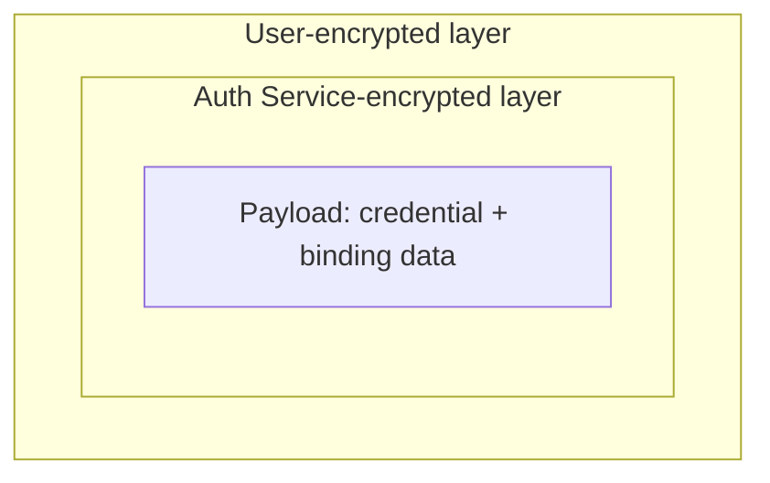

This page describes how Teleport securely stores user-owned credentials for
connected accounts, like a user's GitHub access token used for [GitHub over
HTTPS](../../enroll-resources/git-platforms/github-https.mdx).

## Credential encryption

Each credential is encrypted twice before it is written to the backend storage:

The inner layer is encrypted with a key managed by the Teleport Auth Service.
Only the Auth Service can remove this layer. This key is configured with
`auth_service.user_external_credentials.encryption_mode` in the
`teleport.yaml` configuration file:

(!docs/pages/includes/git-platforms/user-external-credentials-config.mdx!)

The outer layer is encrypted with a key unique to the session. The key is
generated and kept by the session's client, such as `tsh` on the user's machine
or `tbot` in a Beam, so only that session can remove this layer.

## Credential lifecycle and sharing

A credential's lifetime is bound to the lifetime of the user's encryption key.
Today, that key is scoped to a single user session and expires along with
the session's certificate. This may change as Teleport introduces more policies
for managing user external credentials in the future.

Connecting an account, such as authorizing access to GitHub, is what
creates the credential in the first place.

The holder of a user's encryption key can share its credentials with another
session owned by the same user or their delegates. For Beams, this sharing
happens automatically, both when the Beam starts and when the user connects an
account later.