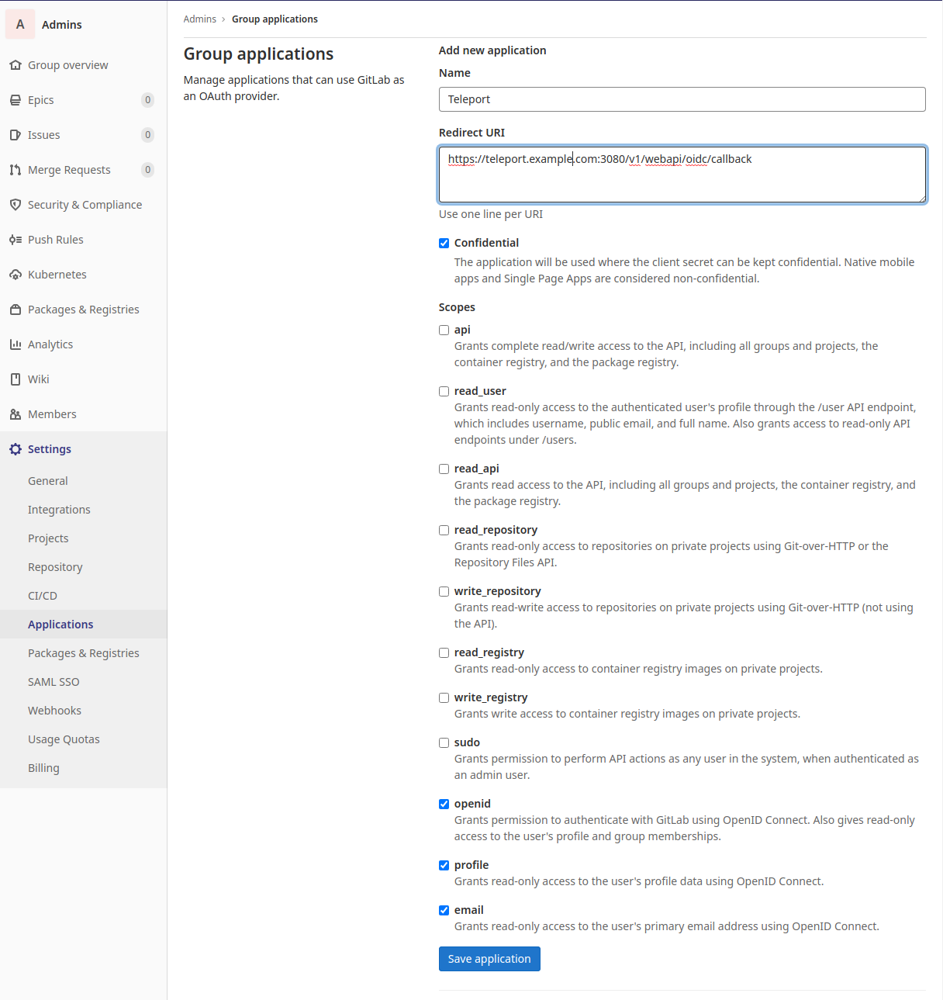
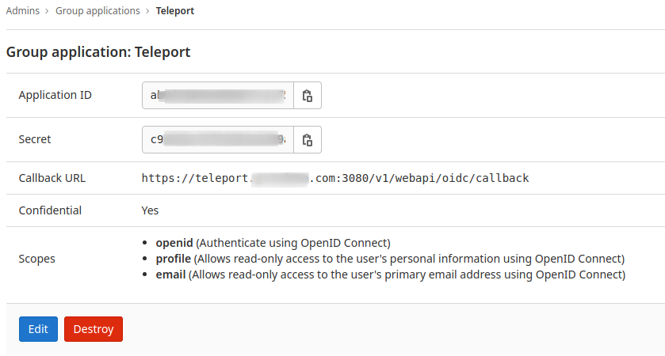

In this guide, you will configure [GitLab](https://www.gitlab.com/) to issue
credentials to specific groups of users. When used in combination with role
based access control (RBAC), it allows administrators to define policies like:

- Only members of the "DBA" group can access PostgreSQL databases.
- Only members of "ProductionKubernetes" can access production Kubernetes clusters.
- Developers must never SSH into production servers.

## How it works

(!docs/pages/includes/sso/how-it-works.mdx idp="GitLab"!)

## Prerequisites

- At least two groups in GitLab with users assigned. In our examples below,
  we use a parent group named `company` with two subgroups, `admins` and
  `devs`.
- Teleport role with access to maintaining `oidc` resources. This is available
  in the default `editor` role.

(!docs/pages/includes/edition-prereqs-tabs.mdx edition="Teleport Enterprise"!)

- (!docs/pages/includes/tctl.mdx!)

## Step 1/3. Configure GitLab

You should have at least one group configured in GitLab to map to Teleport roles.
In this example we use the subgroups `admins` and `devs`, nested under the
parent group `company`. Assign users to each of these groups.

1. Create an application in one of your groups (**Group overview** ->
   **Settings** -> **Applications**) that will allow using GitLab as an OAuth
   provider to Teleport.

   Assign <Var name="teleport.example.com" /> to your Teleport Proxy Service's
   public address. If you have a self-hosted cluster with multiple public
   addresses for the Teleport Proxy Service (the value of
   `proxy_service.public_addr` in the Teleport configuration file), ensure that
   this address points to the first one listed.

   Settings:

   - Redirect URL: `https://<Var name="teleport.example.com" />:443/v1/webapi/oidc/callback`.
   - Check `Confidential`, `openid`, `profile`, and `email`.

   GitLab returns the `groups` claim through its UserInfo endpoint rather than
   the ID token. The `openid` scope is all Teleport needs to receive it. GitLab
   does not offer a separate `groups` scope, so do not request one.

   

1. Collect the `Application ID` and `Secret` in the Application. These will be
   used in the Teleport OIDC auth connector:

   

1. Confirm the GitLab issuer address.

   For GitLab.com, the issuer address is `https://gitlab.com`. This allows
   Teleport to access the Open ID configuration at
   `https://gitlab.com/.well-known/openid-configuration`. If you are self
   hosting, the issuer address is the path to your GitLab instance.

## Step 2/3. Connect GitLab to Teleport

In this section, you will create an authentication connector that provides
Teleport with the information it needs to exchange OIDC messages with GitLab and
issue certificates to users.

### Assign a role mapping

When a user authenticates to Teleport, the Teleport Auth Service issues SSH and
TLS certificates to the user that contain the user's Teleport roles.

For SSO authentication connectors, the Auth Service determines which roles to
encode in the certificate by reading the authentication connector's **role
mapping**. The role mapping indicates which Teleport roles to assign based on
data that your identity provider stores about the user.

When you configure an authentication connector using the `tctl` CLI, a role
mapping takes the following format:

```text
<claim_name>,<claim_value>,<teleport_role_1>,<teleport_role_2>,...,<teleport_role_n>
```

For the purpose of this guide, assign two separate role mappings:

- A more permissive role mapping: <Var name="gitlab_mapping_1" initial="groups,company/admins,auditor,editor" />
- A more restrictive role mapping: <Var name="gitlab_mapping_2" initial="groups,company/devs,access" />

Edit <Var name="gitlab_mapping_1" /> and <Var name="gitlab_mapping_2" /> to
match your GitLab groups and the Teleport roles you want to assign.

GitLab's `groups` claim reports the full path of a group, including any parent
group. For the `admins` and `devs` subgroups of `company` used throughout this
guide, the claim value Teleport receives is `company/admins` and `company/devs`,
not the bare subgroup name. Use the full path as the claim value when you
configure the connector below.

### Configure an OIDC connector

Create an OIDC connector resource using `tctl`.

On your workstation, create a file called `client-secret.txt` consisting only of
your client secret.

<Tabs>
<TabItem label="GitLab.com">
Replace the application ID and secret with the values from GitLab.
With the default role mappings, this command maps the `admins` subgroup of
`company` to the `auditor` and `editor` roles and the `devs` subgroup to the
`access` role, and writes the connector definition to `oidc.yaml`.

```code
$ tctl sso configure oidc --preset gitlab \
--id <APPLICATION-ID> \
--secret $(cat client-secret.txt) \
--claims-to-roles <Var name="gitlab_mapping_1" /> \
--claims-to-roles <Var name="gitlab_mapping_2" /> > oidc.yaml
```

</TabItem>
<TabItem label="Self-hosted">
Replace the application ID and secret with the values from GitLab, and replace
`https://gitlab.company.com` with the path to your self-hosted GitLab instance.
With the default role mappings, this command maps the `admins` subgroup of
`company` to the `auditor` and `editor` roles and the `devs` subgroup to the
`access` role, and writes the connector definition to `oidc.yaml`.

```code
$ tctl sso configure oidc --preset gitlab \
--id <APPLICATION-ID> \
--issuer-url https://gitlab.company.com \
--secret $(cat client-secret.txt) \
--claims-to-roles <Var name="gitlab_mapping_1" /> \
--claims-to-roles <Var name="gitlab_mapping_2" /> > oidc.yaml
```

</TabItem>
</Tabs>

The resulting `oidc.yaml` file looks like this:

```yaml
kind: oidc
metadata:
  name: gitlab
spec:
  claims_to_roles:
  - claim: groups
    roles:
    - auditor
    - editor
    value: company/admins
  - claim: groups
    roles:
    - access
    value: company/devs
  client_id: <APPLICATION-ID>
  client_secret: <APPLICATION-SECRET>
  display: GitLab
  issuer_url: https://gitlab.com
  prompt: none
  redirect_url: https://<Var name="teleport.example.com" />:443/v1/webapi/oidc/callback
version: v3
```

(!docs/pages/includes/sso/username-claim.mdx!)

<details>
<summary>Changing the callback address</summary>

(!docs/pages/includes/sso/change-callback.mdx!)

</details>

### Test the connector

Test the connector resource by piping the file to `tctl sso test`:

```code
$ cat oidc.yaml | tctl sso test
```

After authorizing the application in GitLab you should get a
**Login Successful** message in your web browser. Otherwise, consult the output
of the command to diagnose.

### Create the connector

Create the connector using `tctl`:

```code
$ tctl create -f oidc.yaml
```

The Web UI will now contain a new button: "Login with GitLab". The CLI is
the same as before:

```code
$ tsh --proxy=<Var name="teleport.example.com" /> login
```

This command will print the SSO login URL and will try to open it
automatically in a browser.

<Admonition
  type="tip"
  title="Tip"
>
  Teleport can use multiple OIDC/SAML connectors. In this case a connector name
  can be passed via `tsh login --auth=connector_name`.
</Admonition>

<Admonition
  type="note"
  title="IMPORTANT"
>
  Teleport only supports sending party initiated flows for OIDC Connect. This
  means you can not initiate login from your identity provider, you have to
  initiate login from either the Teleport Web UI or CLI.
</Admonition>

## Step 3/3. Configure authentication preferences

(!docs/pages/includes/sso/cap.mdx type="oidc"!)

## Next steps

(!docs/pages/includes/sso/next-step-traits.mdx!)

## Troubleshooting

(!docs/pages/includes/sso/oidc-login-troubleshooting.mdx!)
